<div align="center">

# V01 — TinyML CAN Intrusion Detection with QAT and INT8

**A multi-class CAN intrusion detection experiment using a neural network, Quantization-Aware Training, and full-integer TensorFlow Lite conversion.**


</div>

---

## Overview

This implementation evaluates a compact feed-forward neural network for classifying CAN traffic. It compares three model variants:

1. A Float32 Keras baseline.
2. A Quantization-Aware Training (QAT) model.
3. A full INT8 TensorFlow Lite model converted from the QAT model.

All three variants are evaluated on the same held-out test partition. The experiment examines classification performance, serialized model size, and prediction agreement after quantization.

### Key results

| Metric | Float32 baseline | QAT model | Full INT8 TFLite |
|:--|--:|--:|--:|
| Test accuracy | 99.8543% | 99.7223% | **99.7223%** |
| Macro-average ROC AUC | 1.000 | 1.000 | 1.000 |
| Prediction agreement with INT8 | 99.8798% | 100.0000% | 100.0000% |

### Model-size comparison

| Artifact | Size |
|:--|--:|
| Float32 TFLite | **49.23 KiB** |
| Full INT8 TFLite | **15.83 KiB** |
| Absolute reduction | 33.4 KiB |
| Relative reduction | **67.84%** |
| Size ratio | **3.109× smaller** |

The size reduction is calculated from the serialized Float32 TFLite and full INT8 TFLite files. It does not represent measured RAM usage, inference latency, or power consumption.

---

## Dataset

| Property | Details |
|:--|:--|
| Dataset | SynCAN2025 |
| Source | [Hugging Face dataset](https://huggingface.co/datasets/Thi-Thu-Huong/SynCAN2025) |
| Loader | Hugging Face `datasets` |
| Split selection | `train`, if available; otherwise the first available split |
| Sampling | Full selected split (`SAMPLE_SIZE = None`) |
| Target column | `Label` |
| Required columns | `ID`, `Length`, `Data`, `Label` |
| Random seed | `42` |

The notebook loads the dataset directly from Hugging Face and shuffles the selected split using seed 42. The notebook comment describes the dataset as approximately 717k rows; the exact number loaded is printed at runtime and may depend on the dataset revision and available split.

### Traffic classes

| Class | Description |
|:--|:--|
| `Normal` | Normal CAN traffic |
| `DoS` | Denial-of-Service traffic |
| `Flooding` | Flooding traffic |
| `Malfunction` | Malfunction traffic |
| `Impersonation` | Impersonation traffic |
| `Janus` | Janus-labeled traffic |

The dataset is imbalanced, with Normal traffic as the largest class. Balanced class weights are calculated from the training labels and used during training.

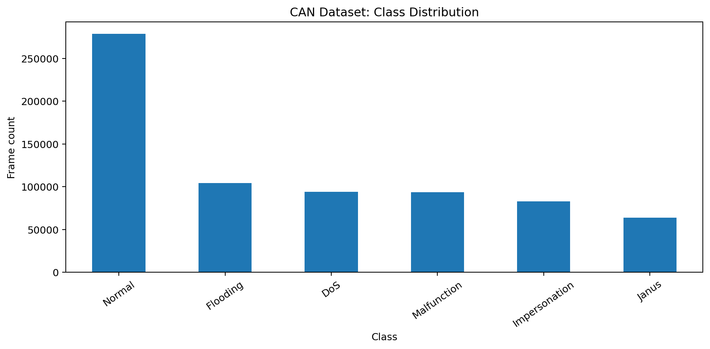

---

## Methodology

The workflow below shows the complete data preparation, training, quantization, conversion, and evaluation process.

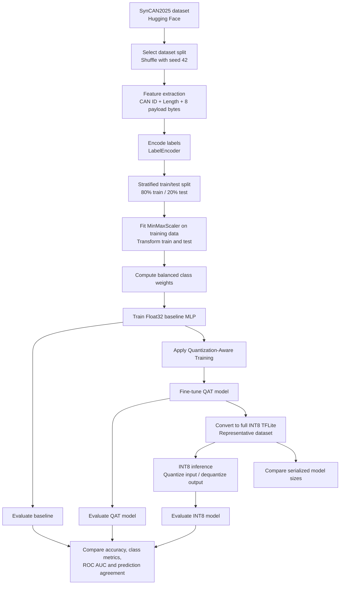

### 1. Feature extraction

Each CAN frame is represented by ten numerical features.

| Feature | Source | Description |
|:--|:--|:--|
| `CAN_ID_numeric` | `ID` | CAN identifier converted to an integer |
| `DLC` | `Length` | Frame length |
| `DATA[0]`–`DATA[7]` | `Data` | Eight payload bytes converted from hexadecimal to integers |

Payload strings are parsed from space-separated or compact hexadecimal representations. Parsed bytes are represented as integers from 0 to 255. The feature vector is padded to eight payload bytes; missing or unparseable payload values use a zero-filled fallback.

The resulting feature matrix contains ten columns and is cast to `float32`. The target labels are converted to integer class indices using scikit-learn's `LabelEncoder`.

**Feature observation:** In the supplied run, `DATA[0]` and `DATA[1]` appear constant at zero in the feature-distribution plot. Their Pearson correlations are therefore undefined and appear blank in the correlation heatmap.

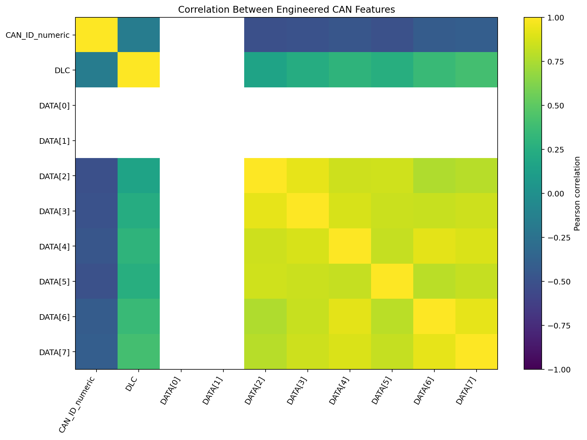

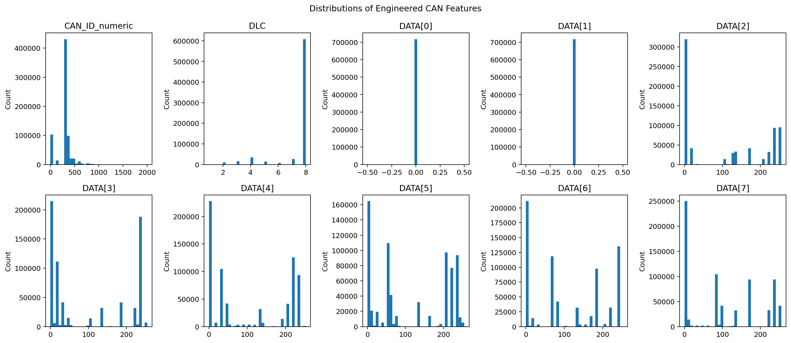

### 2. Data preparation

| Setting | Value |
|:--|:--|
| Train/test split | 80% / 20% |
| Split strategy | Stratified |
| Random state | `42` |
| Scaler | `MinMaxScaler` |
| Scaler fitting | Training partition only |
| Class balancing | `compute_class_weight(class_weight="balanced")` |
| Validation split | 20% of training data during model fitting |

The scaler is fitted only on the training partition and then applied to both training and test data. This prevents the held-out test data from influencing the scaling parameters.

### 3. Float32 baseline model

The baseline is a Keras Sequential fully connected neural network.

| Layer | Configuration |
|:--|:--|
| Input | 10 features |
| Dense 1 | 128 units, ReLU, L2 regularization = 0.001 |
| Dropout 1 | 0.30 |
| Dense 2 | 64 units, ReLU, L2 regularization = 0.001 |
| Dropout 2 | 0.30 |
| Dense 3 | 32 units, ReLU, L2 regularization = 0.001 |
| Dropout 3 | 0.20 |
| Output | 6 units, Softmax |

#### Baseline training configuration

| Parameter | Value |
|:--|:--|
| Optimizer | Adam |
| Learning rate | 0.001 |
| Loss | Sparse categorical cross-entropy |
| Metric | Accuracy |
| Maximum epochs | 80 |
| Batch size | 128 |
| Class weights | Balanced weights from training labels |
| Early stopping | `val_loss`, patience = 10, restore best weights |
| Learning-rate callback | Reduce on plateau, patience = 4 |

The notebook configures `ReduceLROnPlateau` with `min_lr=0.001`, equal to the initial learning rate. Therefore, the callback cannot reduce the learning rate below its initial value in this configuration.

### 4. Quantization-Aware Training

The trained Float32 baseline is passed to `tfmot.quantization.keras.quantize_model()`. QAT inserts fake-quantization operations during fine-tuning so that the model can adapt to quantization effects before conversion.

| Parameter | Value |
|:--|:--|
| Starting model | Trained Float32 baseline |
| API | `tfmot.quantization.keras.quantize_model()` |
| Optimizer | Adam |
| Learning rate | 0.0001 |
| Loss | Sparse categorical cross-entropy |
| Maximum epochs | 25 |
| Batch size | 128 |
| Class weights | Same balanced training weights |
| Early stopping | `val_loss`, patience = 6, restore best weights |

The notebook uses `tf_keras` with `TF_USE_LEGACY_KERAS=1` for compatibility with the TensorFlow Model Optimization workflow. Set the environment variable before importing TensorFlow. Restart the notebook kernel if TensorFlow has already been imported.

### 5. Full INT8 TensorFlow Lite conversion

The QAT model is converted using `tf.lite.TFLiteConverter`.

| Conversion setting | Value |
|:--|:--|
| Optimization | `tf.lite.Optimize.DEFAULT` |
| Representative dataset | Up to the first 1,000 scaled training samples |
| Supported operations | `TFLITE_BUILTINS_INT8` |
| Input tensor type | `int8` |
| Output tensor type | `int8` |

The notebook checks that the converted model has INT8 input and output tensors. During inference, scaled test features are quantized using the input tensor's scale and zero-point. The output tensor is dequantized using its scale and zero-point before selecting the predicted class.

---

## Experimental Results

The values below are from the supplied `model_comparison_summary.csv`, `per_class_metrics.csv`, and generated plots.

### 1. Overall test accuracy

| Model | Test accuracy | Difference from baseline |
|:--|--:|--:|
| Float32 baseline | 99.8543% | — |
| QAT model | 99.7223% | -0.1320 percentage points |
| Full INT8 TFLite | **99.7223%** | **-0.1320 percentage points** |

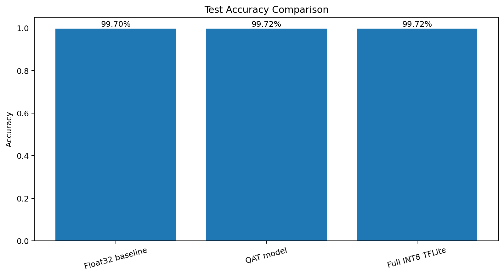

### 2. Per-class metrics — Full INT8 TFLite

| Class | Precision | Recall | F1-score |
|:--|--:|--:|--:|
| DoS | 1.000000 | 1.000000 | 1.000000 |
| Flooding | 1.000000 | 1.000000 | 1.000000 |
| Impersonation | 0.976947 | 1.000000 | 0.988339 |
| Janus | 0.999217 | 1.000000 | 0.999609 |
| Malfunction | 1.000000 | 1.000000 | 1.000000 |
| Normal | 1.000000 | 0.992786 | 0.996380 |

The QAT model reports the same class-wise values. The Float32 baseline differs slightly for Flooding, Janus, and Normal.

| Class | Baseline precision | Baseline recall | Baseline F1-score |
|:--|--:|--:|--:|
| DoS | 1.000000 | 1.000000 | 1.000000 |
| Flooding | 0.998661 | 1.000000 | 0.999330 |
| Impersonation | 0.976947 | 1.000000 | 0.988339 |
| Janus | 0.999139 | 1.000000 | 0.999569 |
| Malfunction | 1.000000 | 1.000000 | 1.000000 |
| Normal | 1.000000 | 0.992266 | 0.996118 |

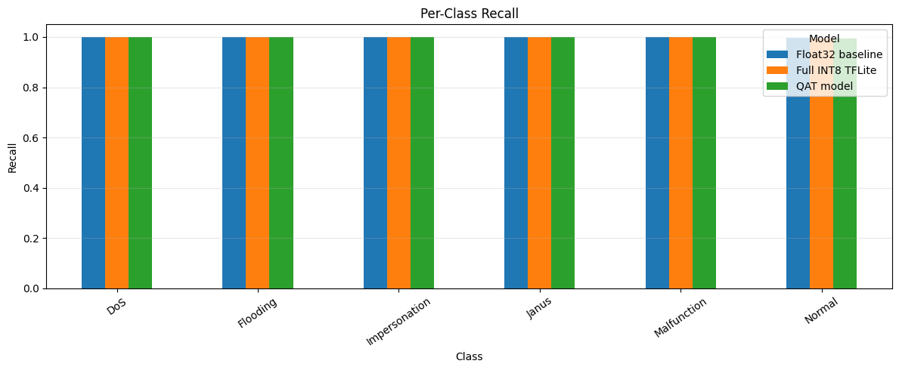


### 3. Confusion matrices

The normalized confusion matrices show high class-wise recall across all three model variants. The lowest recall is for the Normal class: 99.2266% for the Float32 baseline and 99.2786% for QAT and INT8.

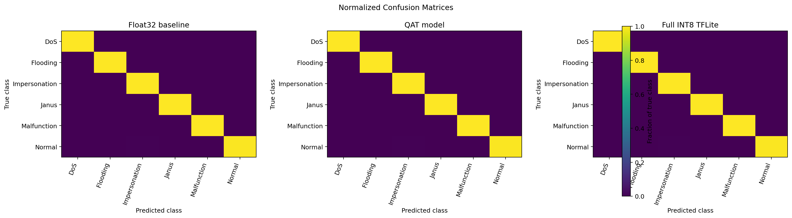

### 4. ROC-AUC

| Model | Macro-average one-vs-rest ROC-AUC |
|:--|--:|
| Float32 baseline | 1.000 |
| QAT model | 1.000 |
| Full INT8 TFLite | 1.000 |

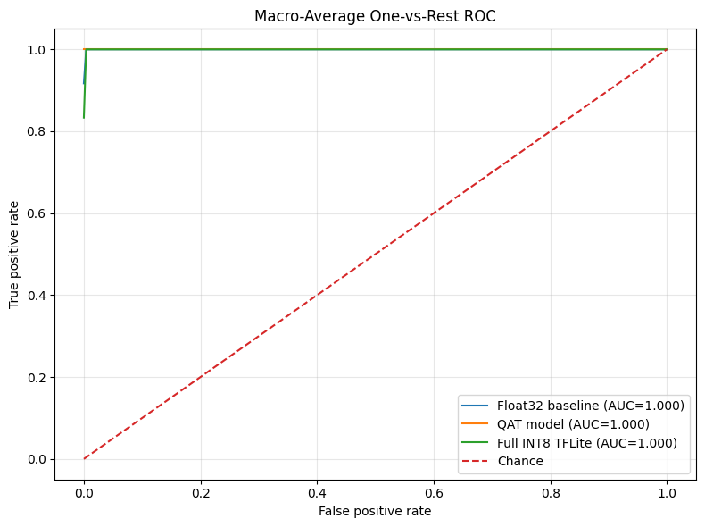

### 5. Model-size reduction

| Artifact | Size |
|:--|--:|
| Float32 TFLite | **49.23 KiB** |
| Full INT8 TFLite | **15.83 KiB** |
| Absolute reduction | 33.4 KiB |
| Relative reduction | **67.84%** |
| Size ratio | **3.109× smaller** |

The reduction is calculated as:

```text
((Float32 size - INT8 size) / Float32 size) × 100

((49.23046875 - 15.828125) / 49.23046875) × 100 = 67.84%
```

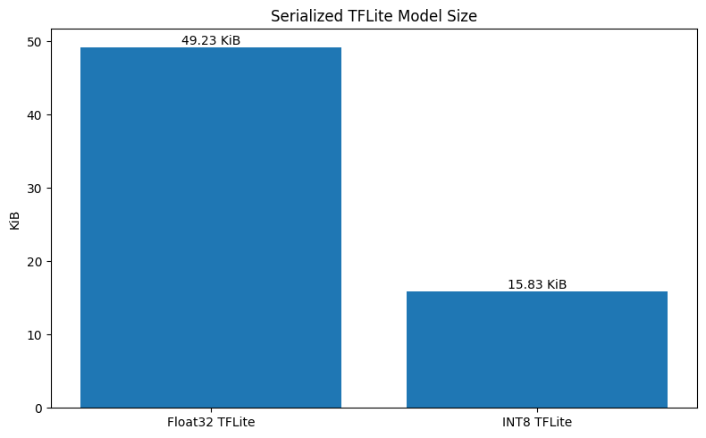

This is a reduction in serialized model-file size. RAM use, target-device flash use, inference latency, throughput, and power consumption were not established by this size comparison.

### 6. Prediction agreement

Prediction agreement is the proportion of test samples for which two models return the same predicted class.

| Comparison | Agreement |
|:--|--:|
| Float32 baseline vs INT8 | 99.8798% |
| QAT vs INT8 | 100.0000% |

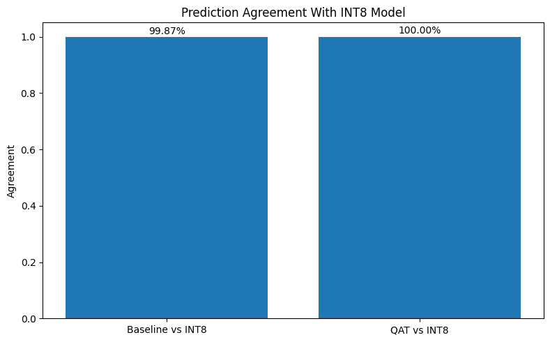

### 7. Training curves and confidence

The training curves show the baseline and QAT training/validation accuracy and loss across epochs.

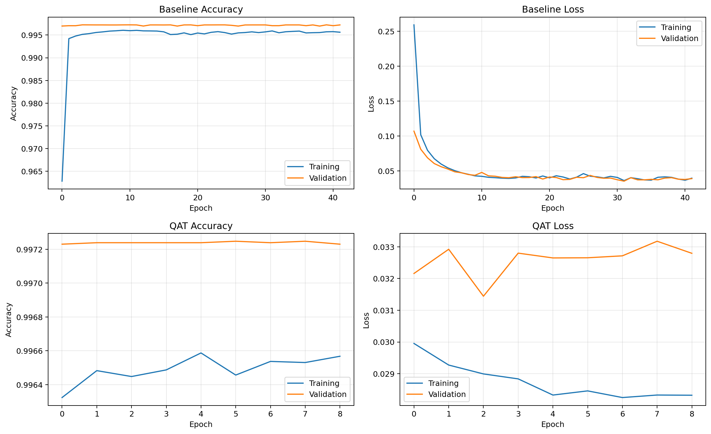

The confidence plot compares maximum predicted probabilities for correct and incorrect predictions across the three model variants.

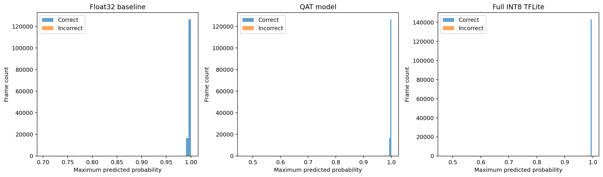

---

## Interpretation

On this held-out test partition:

- QAT decreased test accuracy from 99.8543% to 99.7233%.
- Full INT8 TFLite retained the QAT model's reported test accuracy.
- QAT and INT8 predictions agreed on 100% of test samples.
- The INT8 TFLite file was 67.84% smaller than the Float32 TFLite reference.
- The lowest reported class-wise precision was for Impersonation (0.976947).
- The lowest reported class-wise recall was for Normal (0.992786) in the QAT and INT8 models.

These results apply to this dataset split and experiment configuration. They do not establish generalization to unseen vehicles, independent recording sessions, different CAN configurations, or live automotive networks.

---

## Generated Artifacts

The notebook writes model and metadata files to its working directory.

| File | Description |
|:--|:--|
| `ids_model_float32.keras` | Trained Float32 Keras baseline |
| `ids_model_qat.keras` | QAT Keras model |
| `ids_model_float32.tflite` | Float32 TFLite reference model |
| `ids_model_qat_int8.tflite` | Full INT8 QAT TFLite model |
| `ids_qat_int8_metadata.json` | Feature order, label mapping, scaler, quantization parameters, and accuracy metadata |

The notebook creates exploratory figures under `can_ids_results/` and consolidated dashboard outputs under `can_ids_all_visuals/`. The dashboard includes `per_class_metrics.csv` and `model_comparison_summary.csv`.

---

## Installation

Install the dependencies from this version's requirements file:

```bash
pip install -r requirements.txt
```

The QAT workflow specifically uses:

```bash
pip install "tf-keras==2.21.0" "tensorflow-model-optimization==0.8.1"
```

The notebook sets `TF_USE_LEGACY_KERAS=1` before importing TensorFlow and uses `tf_keras` for model construction and QAT compatibility. Use a compatible TensorFlow environment and execute the setup cell before importing TensorFlow.

## Execution

1. Open `notebooks/tinyml_can_ids_qat_int8.ipynb` in Jupyter or a compatible notebook environment.
2. Run the dependency setup cell.
3. Restart the kernel/runtime if requested.
4. Execute the notebook sequentially from the beginning.
5. Allow the dataset to download from Hugging Face.
6. Run the evaluation and visualization sections.
7. Review the saved models, metadata, figures, and CSV metrics.

An internet connection is required for the initial dataset download. The notebook uses the full selected dataset split by default; training time and memory use depend on the execution environment.

---

## Limitations

- **Frame-level features:** The model uses CAN ID, length, and payload bytes. It does not currently model temporal windows or message sequences.
- **Constant payload features:** `DATA[0]` and `DATA[1]` appear constant in the supplied run.
- **Dataset-specific evaluation:** A random stratified split from one selected dataset split does not establish cross-vehicle or cross-session generalization.
- **Class imbalance:** Class weights are used, but dataset coverage and labeling assumptions still affect the results.
- **Offline inference:** The notebook evaluates recorded data. It does not implement live CAN capture, gateway integration, or traffic blocking.
- **Hardware performance:** Target-device latency, peak RAM, flash requirements, power consumption, and real-time throughput have not been measured.
- **Deployment readiness:** This is an experimental research model, not a certified automotive security component.

## References

- [SynCAN2025 dataset — Hugging Face](https://huggingface.co/datasets/Thi-Thu-Huong/SynCAN2025)
- [TensorFlow Model Optimization — Quantization-Aware Training](https://www.tensorflow.org/model_optimization/guide/quantization/training)
- [TensorFlow Lite — Quantization](https://www.tensorflow.org/lite/performance/post_training_quantization)

---

<div align="center">

**CANDICE | CAN Automotive Intrusion Detection Lab**

*V01 — TinyML, Quantization-Aware Training, and Full INT8 TensorFlow Lite*

</div>
